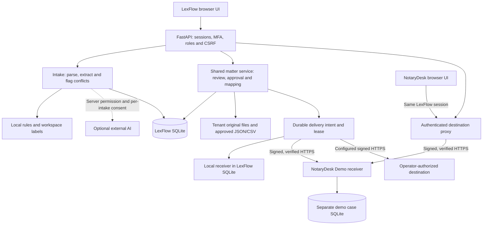
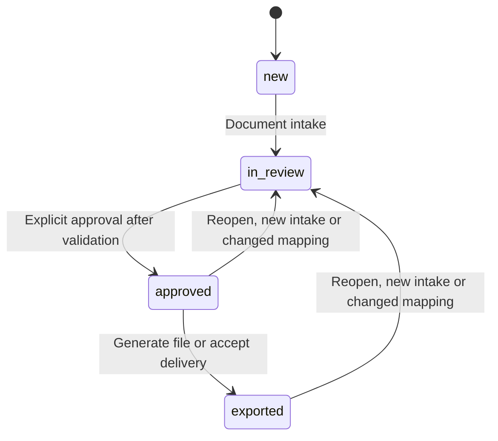

# Product Architecture and Boundaries

**Release:** 0.11.0-prototype · **Updated:** 23 October 2026

## High-level view

The local Python launcher binds HTTP to loopback; the hardened stack places the application behind an HTTPS proxy. NotaryDesk is a separate TLS server thread and database in the same application process and data volume. It demonstrates a service boundary, not independent hosted infrastructure. Its browser UI shares LexFlow authentication.

## Main entities

- **Tenant:** isolated demo office, keyed by `tenant_id`.
- **User:** assigned to exactly one tenant; admin, reviewer or analyst.
- **Session:** short-lived random token stored as SHA-256 hash, plus CSRF token.
- **MFA credential:** user-bound encrypted authenticator secret, last accepted step and hashed recovery codes; sign-in challenges have a separate expiry/attempt count.
- **Matter:** case metadata, matter type, status and explicit approval.
- **Document:** original bytes on disk, extracted text in database, digest and tenant scope.
- **Candidate:** extracted value, confidence heuristic, originating document and evidence text.
- **Field review:** human-confirmed field value, candidate link (or manual override), reviewer and time.
- **Export:** stored mapped JSON/CSV, approved matter and creator.
- **Transfer/job:** tenant-scoped key, approved-payload fingerprint, immutable payload snapshot, destination binding, attempt count, lease and receipt state.
- **Destination case:** independently stored encrypted received payload, receipt, preparation stage and revision in NotaryDesk Demo.
- **Audit:** HMAC-chained per workspace, with verification and externally retainable checkpoints. The database is not immutable.

## Matter states

Reviewing fields does not approve a matter automatically. `exported` records that a file was generated or a delivery accepted; a file alone does not prove destination receipt. NotaryDesk preparation stages (`received`, `in_preparation`, `ready_for_review`) belong to the destination and do not change the source matter's approval.

Uploading a new document invalidates existing field confirmations and the current approval, so previously verified values must be reviewed in the context of the new evidence. Earlier exports are marked superseded and their download endpoints return HTTP 409. Files downloaded previously cannot be recalled. Mapping changes also reset approval for affected approved matters. Review changes and invalidations preserve previous values, candidate IDs, reviewers and notes in tenant-scoped audit events.

## Matter schemas

- `property_purchase` — buyer, seller, price, property address, land register; optional email/date/parcel.
- `inheritance` — deceased, heir, estate reference.
- `company_formation` — company name, founder, registered address.
- `general` — client name and matter reference.

Local extraction intentionally uses labeled values, not inferred legal opinions. Numeric confidence represents a rule or model hint, not a validated statistical probability. This conservative approach makes failure modes visible but does not fully solve complex legal data extraction.

## Isolation and request flow

Every authenticated API query scopes records by `tenant_id`. Documents and exports also use tenant-specific filesystem subdirectories. The sample tenants can be used to demonstrate blocked cross-workspace access. This is **logical tenant isolation, not equivalent to the dedicated per-tenant databases, KMS keys and storage accounts shown as a target architecture in the original presentation**.

## Approvals and simulated connectors

1. Original document is uploaded or text is pasted.
2. Every file is parsed before external processing or durable changes. Original files, document metadata, candidates, review invalidation and audit events are saved as one batch; storage errors roll back the database and remove the new files. Parsing warnings remain available in the document viewer.
3. The API collates candidates from all documents, normalizes comparison values and flags conflicts.
4. Reviewer confirms each required field using a candidate or verified manual correction.
5. Matter is explicitly approved only when required fields have valid, confirmed values, every optional or required conflict has been resolved, and at least one source document exists.
6. Workspace-specific field mappings convert internal keys to destination field paths.
7. JSON or CSV is generated as a local file, and an audit event is recorded.

| Identifier | Behavior |
|---|---|
| `approved_export` / `notary_demo` | Local JSON/CSV file profiles; both mark JSON as `not_a_live_transmission: true` |
| `demo_receiver` | Durable local receiver record and receipt inside LexFlow; `simulated: true` |
| `demo_notary` | Actual signed local HTTPS request to fictional NotaryDesk, separately encrypted received payload and signed receipt; `simulated: true` |
| `webhook` | Signed HTTPS to an operator-configured workspace destination; `simulated: false`, without claiming vendor-specific support |

NotaryDesk's case payload is encrypted; its receipt, stage/history and identifying metadata are not whole-database encrypted. The entire data/backup volume still needs appropriate protection.

## Identity and session flow

Password-only login creates a session for an unenrolled demo account. An enrolled account receives a five-minute challenge and no session until an authenticator or recovery code verifies. TOTP uses 30-second steps with a one-step clock window and rejects reused steps. Recovery codes are stored as user-bound hashes and consumed once.

In the hardened profile, an unenrolled account gets only enrollment/configuration/identity/logout access; case routes return 403. Activation revokes other sessions, marks the retained session as factor-verified and returns recovery codes once. Factor changes require both password and a valid factor. Password reset revokes sessions but preserves enrollment. The default absolute session expiry is 12 hours and inactivity expiry is 30 minutes.

## Planned connector interface

Production systems should introduce a connector interface with `validate_access()`, `map_schema()`, `dry_run()`, `write_approved_data()` and `audit_receipt()` methods, each with explicit least-privilege credentials and idempotency keys. Use documented official APIs/imports before attempting browser or UI automation, and validate with the relevant vendor, regulator and notarial customers.

## Versioned workflows, integration receipts and pilot evidence

`workflows.py` stores only schema/field/literal-label configuration, version and enabled state. Preview text is transient. Escaped labels prevent arbitrary regex execution. Rules are tenant scoped and applied before normal candidate review to future intake; they never auto-confirm a field.

`integrations.py` reuses the same approval and mapping validation as exports. A dry-run fingerprint binds the reviewed preview to delivery. Idempotency is tenant scoped; the local receiver writes its payload and receipt in the same transaction. Agent intake receipts commit with documents. HTTPS destinations must verify signatures, enforce workspace/key idempotency and acknowledge receipt. `delivery.py` commits a durable intent and bounded lease, releases the writer lock for network I/O, then records the result. Same-key recovery handles a crash after receiver commit. `matter_service.py` shares approval, field and export invariants across the API and delivery. Scheduling/reconciliation at scale remains future work.

The lease lasts 120 seconds and the HTTPS client uses 10-second timeouts. Approval-invalidating edits to that matter return 409 during an active send; unrelated writers can proceed. Recovery rechecks actor role, approval, payload and destination binding. Pending or abandoned sends can resume through `manage deliver-pending`; uncertain outcomes require explicit same-key retry. A late acceptance for an older approved payload is retained as superseded and cannot mark a newer approval exported. NotaryDesk commits before acknowledgment and signs the raw response, binding acceptance to the original key and transmitted-body digest.

`pilot.py` derives field/activity rates from persisted workflow state and audit events, with explicit numerators and denominators. Work observations and operator baselines are recorded separately. A browser timer reports elapsed work; observation keys protect retries from double counting. Synthetic fixture history can lower audit activity coverage; no evidence is invented to conceal those gaps.

`security.py`, `storage.py`, and `integrity.py` add host restrictions, headers, sign-in throttling, session controls, optional per-workspace artifact encryption, and HMAC verification. A hardened deployment requires external keys, secure cookies, no demo seeding and an HTTPS origin. Dedicated database/storage isolation is delivered by running a separate instance and volume per office; the default multi-office demonstration still uses logical scoping in a shared SQLite database. Extracted text and metadata require encrypted infrastructure storage.

## Snapshots and recovery

`snapshots.py` holds the application writer lock while using SQLite's online backup API and copying original/export files. It separately captures the demo destination database and its local keys/certificate. The v2 HMAC manifest authenticates exact file membership and hashes; verification also checks SQLite/FKs, audit chains, document digests, decrypted artifacts, MFA identity binding and destination payloads.

Restore verifies the source and copied bytes before relocating stored paths into a new directory. It revokes sessions/reset tokens/challenges and clears delivery leases while preserving factors, unused recovery codes, audit history and transfer keys. The destination snapshot is individually consistent; an in-flight cross-store handoff can require same-key reconciliation. External keys are excluded and must be supplied independently. Local demo fallback keys are included, so their snapshot requires private storage.

## Evaluation and release checks

`benchmark.py` reads versioned ground truth and runs offline `rule_extract` without workspace data or external AI. It compares normalized field/value sets, reporting precision, recall, F1, exact-document matches, conflict recall and evidence presence. Reports retain case IDs/counts/field names, without copying source text or extracted values. The supplied 28-case dataset is synthetic and does not assess OCR or office performance.

`.github/workflows/ci.yml` runs backend/UI tests, dependency/syntax checks and a minimum-F1 benchmark, then uploads the report. The [test plan](TEST_PLAN.md) distinguishes local test evidence from hosted CI and unvalidated deployment infrastructure.
